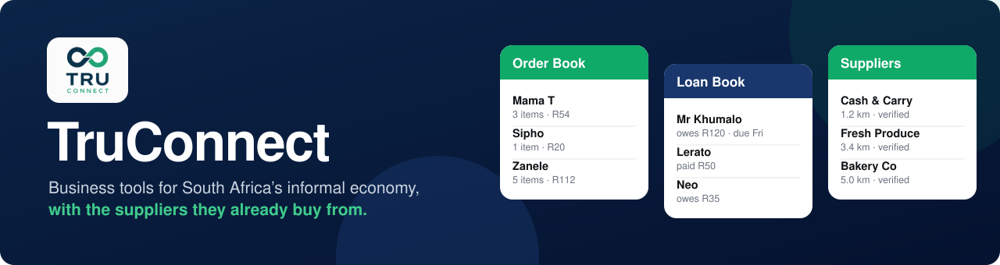
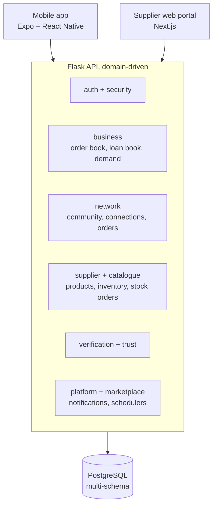

<p align="center">
  
</p>

<p align="center">
  
  
  
  
  
</p>

<p align="center">
  <a href="#the-problem">Problem</a> &middot;
  <a href="#what-a-business-gets">Business tools</a> &middot;
  <a href="#trust-is-built-in">Trust</a> &middot;
  <a href="#architecture">Architecture</a> &middot;
  <a href="#engineering-highlights">Engineering</a> &middot;
  <a href="#run-it">Run it</a> &middot;
  <a href="#documentation">Docs</a>
</p>

---

**TruConnect** is a mobile app, a supplier web portal and an API for the people who trade without a formal storefront: spaza shops, kota and food vendors, salons and barbers, street and market traders, tuck shops and home-based sellers. The business tools are the product. Suppliers are something a business can add, never something it needs.

<table align="center">
  <tr>
    <td align="center"><b>~160 000</b><br>lines of code<br>(Python, TypeScript)</td>
    <td align="center"><b>10</b><br>backend domain areas</td>
    <td align="center"><b>1 400+</b><br>backend tests</td>
    <td align="center"><b>75</b><br>database migrations</td>
    <td align="center"><b>190+</b><br>mobile routes</td>
    <td align="center"><b>3</b><br>apps: mobile, web, API</td>
  </tr>
</table>

## The problem

Spaza shops are the biggest and best-documented group of informal traders. There are more than 150 000 of them, carrying 30-40% of the country’s food spending, and only about 1% accept electronic payment. Most keep no records beyond a paper notebook.

That has two costs. The shop owner has no clear view of who owes what or what is selling. And because nobody has records of how these businesses trade, they are often shut out of finance, even when they trade well.

## The principle: tools stand alone

A business that only ever uses the Order Book, and never buys a thing through TruConnect, is a **complete user**. It is not half a user or a funnel stage.

- No tool needs a supplier connection to work.
- No tool is locked until the business places an order.
- Onboarding does not assume the business wants to buy stock from us.
- A business gets full value on day one with **zero** suppliers on the platform.

This is why TruConnect onboards businesses first. A business needs only something better than a paper notebook. A supplier needs capital, a move off systems that already work, and trust the platform has not earned yet.

## What a business gets

<table>
  <tr>
    <td width="20%"><b>Order Book</b><br>Replaces the paper book where customer orders get written down.</td>
    <td width="20%"><b>Loan Book</b><br>Replaces the month-end credit tab: who owes what, and when it was paid.</td>
    <td width="20%"><b>Community tab</b><br>A feed built from the shop’s own trading: stock to reorder, what is moving fast, suppliers near enough to collect from, and suppliers who sell what the shop actually buys.</td>
    <td width="20%"><b>Category browse</b><br>Stock across every verified supplier, narrowed by search, supplier type and my suppliers.</td>
    <td width="20%"><b>Stock ordering</b><br>Ordering from connected suppliers, with a real record of every order.</td>
  </tr>
</table>

**What a supplier gets:** a shopfront and product catalogue with bulk import, inventory and minimum-order controls, incoming connection requests, stock-order management, and a web portal as well as the mobile app.

## Trust is built in

- **The verification curtain.** Buyers cannot see or order from an unverified supplier. The rule lives in one file, and architecture tests enforce it.
- **Recourse.** A digital order carries an invoice, an amount and a date. A shop that pays and gets nothing has proof, and the platform has grounds to suspend that supplier.
- **Honest ranking.** What a shop buys always outranks what a supplier pays for. A paid plan can only break ties between suppliers who are already equally relevant. It never buys a place above a better match.
- **Cash is allowed on purpose.** Businesses start where they are. Nobody carries R10 000 in cash, so larger orders move to digital payment naturally.

## Architecture



The backend is organised by domain: `src/domains/<area>/<domain>/` with `api/`, `services/`, `repositories/`, `models/` and `schemas/`. The ten areas are auth, business, supplier, network, catalogue, verification, trust, platform, security and marketplace. Shared infrastructure lives in `backend/src/shared/`.

## Engineering highlights

| Practice | What it looks like here |
|---|---|
| **Boundaries that fail the build** | 8 architecture test files in `backend/tests/architecture` break the build when a rule is crossed: the community tab only composes, the demand engine stays independent, the AI layer stays behind its boundary, feed routes keep their roles. |
| **A role on every route** | Every authenticated route pins the role allowed to call it. A route that only says "authenticated" is treated as a bug. |
| **Security as a domain** | Its own audit log, detection, monitoring, analytics, rules and schedulers. |
| **Rate limits per domain** | Auth, business and supplier each define their own. |
| **Migrations** | 75 Alembic migrations over a multi-schema PostgreSQL database. |
| **A test runner that cannot be misused** | `scripts/run_tests.py` sets the environment and the test database and runs one directory at a time. Bare `pytest` is refused on purpose. |
| **Mock-first mobile app** | The app runs against mock data by default, so screens can be built and reviewed without a backend. |
| **A pluggable AI layer** | `src/shared/ai` has providers behind one interface, a fake provider for tests, and boundary tests. |
| **A real web portal** | Cookie sessions, CSRF protection, sign-in and sign-up. It accepts supplier accounts only, by design. |

## Run it

```bash
# backend (Flask + PostgreSQL); configuration comes from environment variables, see backend/src/config.py
cd backend
python app.py                               # dev server on 0.0.0.0:5000
flask db upgrade                            # apply migrations
python scripts/run_tests.py                 # the ONLY supported way to run tests
python scripts/run_tests.py tests/architecture
```

```bash
# mobile app (Expo / React Native, TypeScript)
cd frontend/mobile
npx expo start --dev-client                 # needs a development build; Expo Go cannot run this app
npm run typecheck
```

The app runs against mock data by default. Set `EXPO_PUBLIC_USE_MOCK_API=false` to use the real backend.

```bash
# supplier web portal (Next.js)
cd frontend/web
npm run dev
```

## Documentation

Start with [`docs/v2/V2_03_THE_MARKET_AND_THE_THESIS.txt`](docs/v2/V2_03_THE_MARKET_AND_THE_THESIS.txt). Every later design document builds on its reasoning.

| If you want... | Read |
|---|---|
| The market and the thesis | [`docs/v2/V2_03_THE_MARKET_AND_THE_THESIS.txt`](docs/v2/V2_03_THE_MARKET_AND_THE_THESIS.txt) |
| Product vision and specification | [`docs/00_PROJECT_VISION.txt`](docs/00_PROJECT_VISION.txt), [`docs/01_TRU_CONNECT_PRODUCT_SPECIFICATION.txt`](docs/01_TRU_CONNECT_PRODUCT_SPECIFICATION.txt) |
| Database and API design | [`docs/04_DATABASE_DESIGN.txt`](docs/04_DATABASE_DESIGN.txt), [`docs/05_BACKEND_API_SPECIFICATION.txt`](docs/05_BACKEND_API_SPECIFICATION.txt) |
| Business rules and the trust engine | [`docs/06_BUSINESS_RULES_AND_WORKFLOWS.txt`](docs/06_BUSINESS_RULES_AND_WORKFLOWS.txt), [`docs/07_DATA_AND_TRUST_ENGINE.txt`](docs/07_DATA_AND_TRUST_ENGINE.txt) |
| The feed and demand engine | [`docs/v2/V2_15_THE_FEED_AND_DEMAND_ENGINE.txt`](docs/v2/V2_15_THE_FEED_AND_DEMAND_ENGINE.txt) |
| Supplier verification | [`docs/v2/V2_12_SUPPLIER_VERIFICATION.txt`](docs/v2/V2_12_SUPPLIER_VERIFICATION.txt) |
| Roadmap and ecosystem strategy | [`docs/08_PRODUCT_ROADMAP.txt`](docs/08_PRODUCT_ROADMAP.txt), [`docs/09_ECOSYSTEM_STRATEGY.txt`](docs/09_ECOSYSTEM_STRATEGY.txt) |
| Engineering philosophy | [`docs/enginnering_docs`](docs/enginnering_docs) |
| Operations runbooks | [`docs/operations`](docs/operations) |

## The long view

Informal businesses are often shut out of finance because nobody has records of how they trade, not because they trade badly. Every order placed and paid through TruConnect adds to a verifiable trading history that informal businesses have never had.

That history is treated as a result of building useful tools well. Features are not built only to collect it. Every feature has to solve a real problem for the people using it today.

<details>
<summary><b>Repository map</b></summary>

```
backend/            Flask + PostgreSQL API (domain-driven, multi-schema)
frontend/mobile/    Expo / React Native app (Expo Router, TypeScript)
frontend/web/       Next.js supplier portal
docs/               Product and architecture specs (v2/ holds the current thinking)
tests/              SQL scripts and supporting test material
```

</details>

## Licence

[MIT](LICENSE). You can use, copy, modify and build on this code, the documents and the ideas in them, for any purpose, including commercial use.
